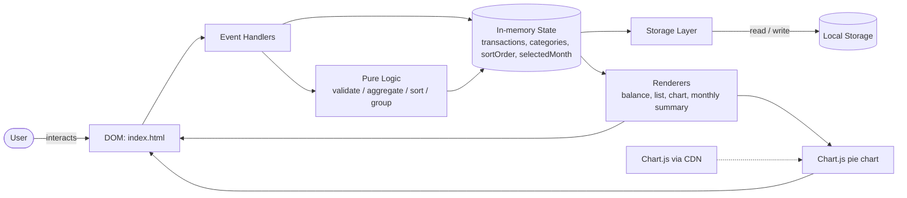
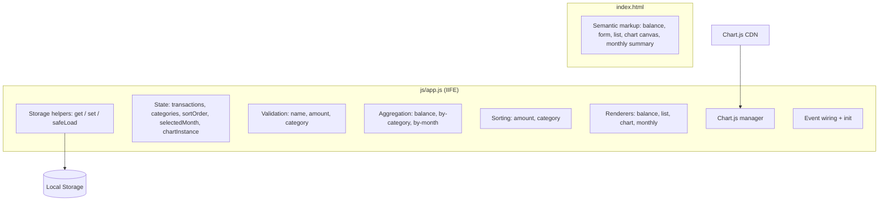

# Design Document

## Introduction

This document describes the technical design for the **Expense & Budget Visualizer** (`expense-budget-visualizer`), a mobile-friendly, client-side web application that lets users record daily spending, review a running balance, browse a scrollable transaction history, and view spending distribution by category in a pie chart. The design is driven by the approved requirements ([requirements.md](./requirements.md)) and follows the project's constraints: a single CSS file in `css/` and a single JavaScript file in `js/`, no UI framework, no backend, and no build step.

## Overview

The Expense & Budget Visualizer is a single-page, browser-only application. Users add expense transactions through a form; the app maintains an in-memory list of transactions, displays a running total balance at the top, renders a scrollable list of transactions (each with a delete control), and draws a pie chart of spending by category. Data persists in the browser's Local Storage so it survives page reloads. Three optional capabilities are included: custom categories, a monthly summary view, and sorting the transaction list by amount or by category.

The application is implemented with plain HTML, CSS, and Vanilla JavaScript. The only external library is **Chart.js**, loaded from a CDN, used solely to render the pie chart. All data processing, storage, and rendering happen client-side; opening `index.html` directly from the filesystem is sufficient to run the app.

### Design Decisions and Rationale

- **Chart.js via CDN (scoped exception to Requirement 10.1).** Requirement 10.1 calls for "no external JavaScript libraries." Chart.js is a single external JavaScript library, so its use is a deliberate, scoped exception, limited to chart rendering. Rationale: Chart.js provides robust, accessible, cross-browser pie chart rendering (slices, legend, tooltips, responsive canvas) without reimplementing SVG/Canvas geometry and without a build step. The rest of the application remains framework-free Vanilla JavaScript, and no other external library is introduced (in particular, the separate `chartjs-plugin-datalabels` plugin is avoided; slice labeling is handled with Chart.js's built-in legend and tooltips). This decision should be confirmed against Requirement 10.1 during review.
- **Transaction date is auto-assigned on creation.** Requirement 1.1 specifies the form fields as item name, amount, and Category (no date field). The glossary defines a Transaction as containing a date, and Requirement 8 (Monthly Summary) groups by the transaction date. To satisfy both, the `date` is set automatically to the calendar day of creation (ISO `YYYY-MM-DD`) when a transaction is added. This keeps the form matching Requirement 1.1 while supporting monthly grouping.
- **Superseding the existing dashboard.** The repository currently contains a different "My Dashboard" app in `index.html` / `css/style.css` / `js/app.js`. Because the Expense & Budget Visualizer is specified as a complete, self-contained app and Requirement 13 constrains the project to a single CSS file and a single JavaScript file, the new application is built into those same three files, superseding the dashboard markup and logic. `list.html` and `revo_id/` are unrelated leftovers and are left untouched.
- **Separation of pure logic from I/O and DOM.** Validation, aggregation (balance, by-category, by-month), and sorting are implemented as pure functions that take data and return data, with no DOM or storage access. This keeps the rendering layer thin and makes the logic directly testable with property-based tests.

## Architecture

The application follows a layered structure inside a single JavaScript IIFE (matching the existing project's conventions: a `Storage` helper, `STORAGE_KEYS` constants, module-level state, a DOM reference block, and an `init()` entry point).



**Layer responsibilities:**

- **DOM layer (`index.html`):** Semantic markup for the balance card, add-transaction form (with custom-category form), sort control, transaction list, chart container (a `<canvas>` plus an empty-state placeholder), and the monthly summary section.
- **Event Handlers:** Wire user actions (form submit, delete, add category, change sort, select month) to the logic/state layer.
- **Pure Logic:** Stateless functions — `validateTransaction`, `validateAmount`, `validateCategoryName`, `computeBalance`, `groupByCategory`, `groupByMonth`, `sortTransactions`. These have no side effects and are the primary targets for property-based tests.
- **State:** Module-level mutable variables holding `transactions`, `categories`, `sortOrder`, `selectedMonth`, and the Chart.js instance.
- **Storage Layer:** `Storage.get` / `Storage.set` (JSON in/out with try/catch) plus a safe-load routine that recovers from corrupted data.
- **Renderers:** Functions that project state into the DOM and into the Chart.js instance. `renderAll` is the single orchestrator called after every mutation.

**Data flow:** A user action triggers an event handler → the handler validates input (pure logic), mutates state, persists via the Storage layer, then calls `renderAll`, which recomputes balance, list, chart, and monthly summary from the current state.



## Components and Interfaces

### UI Components (HTML)

| Component | Purpose | Requirement |
|---|---|---|
| Balance card | Shows the total balance rounded to two decimals at the top of the page. | 3.1, 3.4 |
| Add-transaction form | Fields: item name (`maxlength=100`), amount (`min=0.01`, `max=999999999.99`, `step=0.01`), category `<select>`, and a submit button. | 1.1, 1.2 |
| Custom-category form (optional) | Input for a new category name (`maxlength=50`) and an add button. | 7.1 |
| Sort control (optional) | `<select>` with options "Amount (low to high)" and "Category (A–Z)" placed above the transaction list. | 9.1, 9.2, 9.4 |
| Transaction list | Scrollable container (CSS `overflow-y: auto` with a max height); each item shows name, amount, category, and a delete control. | 2.1–2.5 |
| Spending chart | A Chart.js pie chart on a `<canvas>` with a responsive container; an empty-state placeholder element shown when there is no data. | 4.1, 4.4 |
| Monthly summary (optional) | Lists months (year + month) with totals; selecting a month reveals that month's transactions. | 8.1–8.4 |
| Feedback area | Displays validation, persistence-failure, and recovery messages. | 1.4, 1.5, 5.4, 5.5, 7.4 |

### JavaScript Module Interfaces

Pure logic functions (no DOM, no storage):

```javascript
// Validation
validateTransaction({ name, amount, category }) -> { valid: boolean, errors: string[] }
validateAmount(rawAmount) -> { valid: boolean, value?: number, error?: string }
validateCategoryName(name, existingCategories) -> { valid: boolean, error?: string }

// Aggregation
computeBalance(transactions) -> number          // sum of amounts, rounded to 2 decimals
groupByCategory(transactions) -> { category: amount }   // sum per category
groupByMonth(transactions) -> { "YYYY-MM": { transactions: Transaction[], total: number } }

// Sorting (returns a new sorted copy; never mutates input)
sortTransactions(transactions, sortOrder) -> Transaction[]   // sortOrder: "amount" | "category"
```

Stateful / side-effecting functions:

```javascript
// Mutations (validate, then update state + persist + render)
addTransaction({ name, amount, category }) -> { ok: boolean, error?: string }
deleteTransaction(id) -> void
addCustomCategory(name) -> { ok: boolean, error?: string }
setSortOrder(order) -> void

// Persistence
Storage.get(key, fallback) -> any
Storage.set(key, value) -> boolean            // false on failure
Storage.safeLoadTransactions() -> { data: Transaction[], recovered: boolean }
Storage.safeLoadCategories() -> { data: string[], recovered: boolean }

// Rendering / orchestration
renderBalance()
renderList()
renderChart()
renderMonthlySummary()
renderAll()                                    // called after every mutation
```

### Chart.js Integration

- Chart.js v4 is loaded via a CDN `<script>` placed before `js/app.js` (e.g., `https://cdn.jsdelivr.net/npm/chart.js`). Loading from a CDN requires no build step, consistent with Requirement 10.3. ([Chart.js Getting Started](https://chartjs.org/docs/latest/getting-started/))
- A single `Chart` instance is created once and updated in place (via `chart.data` + `chart.update()`) on each re-render, rather than destroyed and recreated, to keep updates within the 100ms budget (Requirement 12).
- Slice labeling uses Chart.js's built-in **legend** (category names) and **tooltips** (category + amount/percentage on interaction). The separate `chartjs-plugin-datalabels` plugin is intentionally **not** used, to keep the external footprint to a single library. ([chartjs-plugin-datalabels](https://github.com/chartjs/chartjs-plugin-datalabels))
- Empty state: Chart.js has no built-in "no data" message, so when there are no transactions the canvas is hidden and an empty-state placeholder element ("No spending data yet") is shown. ([Chart.js issue #3745](https://github.com/chartjs/Chart.js/issues/3745))
- A guard (`typeof Chart === "undefined"`) prevents a crash if the CDN fails to load; in that case the chart area shows a fallback message while the rest of the app remains functional.

## Data Models

### Transaction

```typescript
interface Transaction {
  id: string;        // unique: `${Date.now()}-${randomSuffix}`
  name: string;      // item name, 1–100 chars (trimmed, leading/trailing whitespace stripped)
  amount: number;    // positive number, 0.01–999,999,999.99, at most 2 decimal places; stored as a Number
  category: string;  // a label from the category set (default or custom)
  date: string;      // ISO date "YYYY-MM-DD", auto-assigned to the creation day
}
```

### Categories

```typescript
type Category = string;        // 1–50 characters, unique (case-sensitive uniqueness)
type Categories = Category[];   // defaults: ["Food", "Transport", "Fun"]; custom categories appended
```

### Sort Order

```typescript
type SortOrder = "amount" | "category";   // default "amount" on first load
```

### Local Storage Keys

| Key | Stored Value | Requirement |
|---|---|---|
| `expense_transactions` | `Transaction[]` | 5.1, 5.2 |
| `expense_categories` | `string[]` (defaults + custom) | 7.3 |
| `expense_sort_order` | `SortOrder` | 9.4 |

### Derived Views (computed, not stored)

- **Balance:** `computeBalance(transactions)` — sum of `amount`, rounded to two decimals.
- **Chart data:** `groupByCategory(transactions)` — `{ category: categoryTotal }`; the set of categories with non-zero totals becomes the chart slices; the sum of all slice values equals the balance.
- **Monthly summary:** `groupByMonth(transactions)` — keyed by `"YYYY-MM"` derived from each transaction's `date`; only months containing at least one transaction are listed; each entry holds its transactions and a `total`.

### In-Memory State

```typescript
let transactions: Transaction[] = [];
let categories: string[] = ["Food", "Transport", "Fun"];
let sortOrder: SortOrder = "amount";
let selectedMonth: string | null = null;   // monthly-summary drill-down
let chartInstance: Chart | null = null;    // Chart.js instance, reused
```

## Correctness Properties

*A property is a characteristic or behavior that should hold true across all valid executions of a system — essentially, a formal statement about what the system should do. Properties serve as the bridge between human-readable specifications and machine-verifiable correctness guarantees.*

The properties below target the pure logic layer (validation, aggregation, sorting, and storage serialization). DOM rendering, Local Storage I/O, CSS layout, cross-browser parity, and performance SLAs are covered by unit, integration, smoke, and manual tests described in the Testing Strategy rather than by properties.

### Property 1: Valid transaction addition

*For any* valid item name (1–100 non-whitespace characters), valid amount (a positive number between 0.01 and 999,999,999.99 with at most two decimal places), and any existing category, adding the transaction appends exactly one new transaction whose `name`, `amount`, and `category` match the submission, whose `date` equals the creation day, whose `id` is unique, and increases the transaction list length by exactly one.

**Validates: Requirements 1.3**

### Property 2: Invalid transaction submissions are rejected

*For any* transaction submission in which the name or category is empty or wholly whitespace, or the amount is not a positive number, exceeds 999,999,999.99, or has more than two decimal places, the submission is rejected: the transaction list is unchanged and a validation error is reported.

**Validates: Requirements 1.4, 1.5**

### Property 3: Balance equals the sum of amounts, rounded to two decimals

*For any* set of transactions (including the empty set), the computed Balance equals the sum of all transaction amounts rounded to two decimal places, and is exactly zero when the set is empty.

**Validates: Requirements 3.1, 3.2, 3.4**

### Property 4: Chart slices aggregate by category and total to the balance

*For any* set of transactions, each chart slice's value equals the sum of the amounts of transactions in that category, the sum of all slice values equals the total Balance, and every slice is labeled with its category name. When the set is empty, there are no slices.

**Validates: Requirements 4.1, 4.2**

### Property 5: Deletion removes exactly the targeted transaction

*For any* transaction list and any transaction within it, deleting that transaction reduces the list length by exactly one and the deleted transaction's `id` no longer appears in the list.

**Validates: Requirements 2.4**

### Property 6: Transaction list rendering reflects the current stored state

*For any* set of stored transactions, the rendered transaction list contains exactly one entry per stored transaction — no more and no fewer.

**Validates: Requirements 2.1**

### Property 7: Monthly grouping partitions transactions by calendar month with correct totals

*For any* set of transactions, the monthly grouping assigns every transaction to exactly one calendar month (identified by its year and month), includes only months that contain at least one transaction, and each month's total equals the sum of the amounts of the transactions assigned to that month.

**Validates: Requirements 8.1, 8.2**

### Property 8: Sorting preserves the multiset and orders by the selected key

*For any* set of transactions and any sort order (amount ascending or category ascending A–Z), the sorted list is a permutation of the input (multiset equal — no transactions added, removed, or altered) and is ordered non-decreasingly by the selected key.

**Validates: Requirements 9.1, 9.2**

### Property 9: Custom category validation and addition

*For any* category name that is non-empty, between 1 and 50 characters, and not already present, adding it appends the category to the category set; *for any* category name that is empty/whitespace, exceeds 50 characters, or duplicates an existing category name, the category set is left unchanged and an error is reported.

**Validates: Requirements 7.1, 7.4**

### Property 10: Persistence round-trip preserves transactions and categories

*For any* set of transactions and any set of categories, serializing them through the storage layer and deserializing them back yields an equivalent set of transactions and an equivalent set of categories.

**Validates: Requirements 5.2, 7.3**

### Property 11: Corrupted storage yields an empty recovered state

*For any* malformed or unparseable value read from storage, the load routine returns an empty transaction list (without throwing) and signals that recovery occurred.

**Validates: Requirements 5.5**

## Error Handling

- **Form validation (Requirements 1.4, 1.5, 7.4).** Invalid submissions are rejected before any state mutation; a specific message identifies the offending field(s) (empty name/amount/category, amount out of range or with more than two decimals, category name empty/too long/duplicate). The transaction list and category set remain unchanged.
- **Amount parsing.** Amount input is parsed defensively: non-numeric strings, `NaN`, `Infinity`, negatives, zero, values above 999,999,999.99, and values with more than two decimal places are all rejected. Decimal-place precision is checked on the string representation before numeric conversion to avoid floating-point surprises.
- **Rounding.** Balance and category/month totals are rounded to two decimals using a fixed-precision routine (e.g., `Math.round((sum + Number.EPSILON) * 100) / 100`) to mitigate binary floating-point drift.
- **Local Storage write failure (Requirement 5.4).** `Storage.set` wraps `localStorage.setItem` in try/catch. On failure it returns `false`; the calling mutation keeps the in-memory transactions intact, and a failure message is shown to the user. The app continues to function in-memory for the session.
- **Corrupted storage on load (Requirement 5.5).** `safeLoadTransactions` / `safeLoadCategories` wrap `JSON.parse` in try/catch. If parsing fails or the parsed value is not the expected shape (array), the routine returns an empty list, displays a recovery message, and the app starts from a clean state rather than throwing.
- **Chart.js unavailable.** A `typeof Chart === "undefined"` guard at render time prevents a crash if the CDN script fails to load; the chart area shows a fallback message while the form, list, and balance continue to work.
- **Empty states.** Distinct empty-state messages are shown for: no transactions in the list (Requirement 2.5), no spending data for the chart (Requirement 4.4), and no transactions in the monthly summary (Requirement 8.4).
- **Unsupported browser (Requirement 11.3).** A small capability check (e.g., `localStorage` and `JSON` support, and Chart.js presence) runs on init; if a required capability is missing, an unsupported-browser message is shown instead of initializing the app.

## Testing Strategy

The feature uses a dual testing approach: **unit tests** for specific examples, edge cases, and integration points, and **property-based tests** for the universal properties of the pure logic layer. The two are complementary.

### Testing the pure logic layer (property-based + unit)

The pure functions (`validateTransaction`, `validateAmount`, `validateCategoryName`, `computeBalance`, `groupByCategory`, `groupByMonth`, `sortTransactions`, and the storage serialization helpers) are exported from `js/app.js` in a way that tests can import (for example, attaching them to a `window.ExpenseApp` namespace in non-production, or placing the logic in a separately importable module path for tests only — without adding a second shipped runtime file, preserving Requirement 13.2). Property and unit tests import these functions directly; they do not exercise the DOM or real Local Storage.

- **Property-based tests** implement the 11 Correctness Properties above using a property-based testing library. For a Vanilla JavaScript project, **[fast-check](https://fast-check.dev/)** is the recommended library (it runs in Node and the browser and pairs well with generators for strings, numbers, and arrays). Each property test:
  - runs a **minimum of 100 iterations** (per the configuration requirement), with generators covering the valid input space and the relevant edge cases (empty/whitespace strings, amounts at the 0.01 and 999,999,999.99 boundaries, amounts with 0/1/2/3 decimal places, duplicate and over-length category names, transactions spanning multiple months, etc.);
  - is tagged with a comment referencing the design property in the format **Feature: expense-budget-visualizer, Property {number}: {property_text}**;
  - implements exactly one correctness property per test.
  - Storage round-trip properties (Property 10, Property 11) use an in-memory mock storage so the property runs cheaply across many iterations; a separate integration test verifies behavior against real `localStorage`.
- **Unit tests** cover specific examples and edge cases that are not universal properties: a single valid add, a single delete, empty/whitespace rejection, an amount with three decimal places rejected, a duplicate category rejected, balance zero on the empty list, and month grouping for a known set of dates. These anchor the behavior with concrete, readable cases.

### Testing the rendering, I/O, and constraints (unit / integration / smoke)

These are not suitable for property-based testing and use example, integration, or smoke tests instead:

- **DOM rendering examples:** the form contains name/amount/category fields with correct limits (1.1, 1.2); a rendered item shows name/amount/category/delete control (2.2); the form clears after a successful add (1.6); empty-state messages for the list (2.5), chart (4.4), and monthly summary (8.4); selecting a month shows that month's transactions (8.3); default sort is by amount on first load (9.4). These run with a DOM implementation such as **jsdom** in Node.
- **Persistence integration:** pre-seed `localStorage`, initialize the app, and assert the stored transactions render on load (5.3); a throwing storage mock verifies in-memory data is retained and a failure message appears (5.4).
- **Chart.js integration:** initialize the app with seeded data in jsdom (with Chart.js mocked or a real canvas shim) and assert the chart's data matches `groupByCategory` (4.1–4.3, 4.4).
- **CSS layout (smoke/manual):** single-column layout with no horizontal scroll at ≤640px viewport width (6.1), and tap targets ≥44×44 CSS pixels (6.2). Verified with a responsive layout assertion (e.g., Playwright/viewport checks) and manual review.
- **Performance (example):** assert balance, list, and chart update within 100ms of an add/delete (12.1–12.3), and the list re-renders within 1s of a sort change (9.3). These are timing assertions, not properties.
- **Static / smoke checks:** at most one CSS file in `css/` and one JS file in `js/` (13.1, 13.2); no runtime framework and no `fetch`/`XHR`/network calls in `app.js` (10.1, 10.2); the app initializes when `index.html` is opened from `file://` with no build step (10.3). These are filesystem/static-analysis checks.
- **Cross-browser (smoke/integration, manual):** consistent layout and functional parity in the latest stable Chrome, Firefox, Edge, and Safari (11.1, 11.2); an unsupported-browser message when a required capability is absent (11.3). Largely manual, optionally automated with Playwright per browser.

### Test tooling and project constraints

- Tests and dev tooling (test runner, `fast-check`, `jsdom`, Playwright) are **development dependencies only** and live outside the shipped `js/` and `css/` directories; they do not affect the app's no-build-step, static-HTML deployment (Requirement 10.3) or the single-file constraints (Requirement 13).
- A test runner such as **Vitest** (or a minimal Node + `fast-check` script) is recommended. Property tests run in Node against the imported pure functions; rendering/integration tests run against jsdom; cross-browser checks optionally run via Playwright.

### Requirement-to-test traceability

| Requirement | Primary test type |
|---|---|
| 1.1, 1.2, 1.6, 2.2, 2.5, 4.4, 8.3, 8.4, 9.4 | Unit / example |
| 1.3, 1.4, 1.5, 2.1, 2.4, 3.1–3.4, 4.1–4.2, 5.2, 5.5, 7.1, 7.3, 7.4, 8.1–8.2, 9.1–9.2 | Property-based (11 properties) |
| 2.3, 6.1, 6.2 | Smoke / manual (CSS) |
| 5.1, 10.1, 10.2, 10.3, 13.1, 13.2 | Smoke / static check |
| 5.3, 5.4, 11.2 | Integration |
| 9.3, 12.1, 12.2, 12.3 | Performance / example |
| 11.1, 11.3 | Cross-browser / edge (manual + smoke) |
